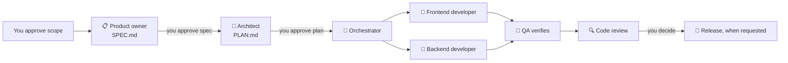

# @rakib045/agentic-sdlc-tools

An AI software team in a box. Install one kit and your coding assistant gets a product owner, an architect, frontend and backend developers, QA, DevOps, security and code reviewers, and an orchestrator that coordinates them. It works with Claude Code, OpenCode, OpenAI Codex, Gemini CLI, GitHub Copilot, and Cursor.

- **Agents:** 9 agents, each with an icon, from 🧭 orchestrator to 🔍 code-reviewer
- **Slash commands:** `/spec` `/plan` `/build` `/test` `/code-review` `/deploy`
- **Skills:** 26 engineering workflows, from spec-driven development to shipping and launch
- **Rules:** one global rule with the team's standards and definition of done
- **Three instruction levels:** `low`, `default`, and `high`, so you can choose how much guidance to install

Requires [Node.js 20 or newer](https://nodejs.org/).

## Quick start

From your project folder, preview the files for the assistant you use, then install them:

```sh
npx @rakib045/agentic-sdlc-tools init --tools claude --dry-run
npx @rakib045/agentic-sdlc-tools init --tools claude --yes
npx @rakib045/agentic-sdlc-tools init --tools claude --instruction-level low 
```

Replace `claude` with `opencode`, `codex`, `gemini`, `github`, or `cursor`. To install for more than one assistant, use a comma-separated list such as `--tools claude,opencode`. After installing, reopen the project in your assistant and follow the [tool-specific start steps](#start-the-kit-in-your-assistant) below.

Check the install and your project setup with:

```sh
npx @rakib045/agentic-sdlc-tools doctor
```

For a project with `SPEC.md`, `PLAN.md`, `package.json`, and Claude Code files installed, a successful check looks like:

```text
PASS spec: SPEC.md
PASS plan: PLAN.md
PASS test: package.json
PASS kit: installed for [claude]

4/4 checks passed.
```

> The package is scoped, so use the full name with `npx`. The bare `npx agentic-sdlc-tools` does not resolve.

## Choose an instruction level

Every agent, command, skill, and rule comes in three versions. Pick one with `--instruction-level`:

| Level | Flag | Template set* | Instructions | Approx. source size vs. high |
|---|---|---|---|---|
| **low** | `--instruction-level low` | 9 agents, 6 commands, 14 skills, 1 rule (30 templates) | Shortest. Only the essentials. Agents load fewer skills. | ~30% of high |
| **default** | no flag, or `--instruction-level default` | 9 agents, 6 commands, 26 skills, 1 rule (42 templates) | Balanced. Every workflow, trimmed for everyday use. | ~67% of high |
| **high** | `--instruction-level high` | 9 agents, 6 commands, 26 skills, 1 rule (42 templates) | Full detail, the complete original instructions. | 100% |

\* Template counts describe the source set, not the number of generated files across all selected tools; some tools render a template into multiple files. Source sizes compare UTF-8 template bytes with `high`; they are not token counts or guaranteed billing savings. Skills can load on demand, so actual context use depends on your assistant and how you use the kit. Choose **low** for shorter instructions, **default** for everyday use, and **high** for the fullest guidance.

The low level installs these skills only:

`planning-and-task-breakdown`, `interview-me`, `spec-driven-development`, `adr-writing`, `api-and-interface-design`, `incremental-implementation`, `test-driven-development`, `frontend-ui-engineering`, `debugging-and-error-recovery`, `conventional-commits`, `ci-cd-and-automation`, `code-review-and-quality`, `review-checklist`, `security-and-hardening`

Files are installed under their normal names. The levels differ only in the template they come from, so `.claude/agents/orchestrator.md` is the same path at every level. The installer drops the level suffix for you.

To switch levels in a project you already set up, add `--force`. The original files are kept as `*.bak`:

```sh
npx @rakib045/agentic-sdlc-tools init --instruction-level low --force
```

## Your team

| Icon | Agent | What it does |
|---|---|---|
| 🧭 | `orchestrator` | Plans the work, delegates each task to the right agent, and tracks progress |
| 📋 | `product-owner` | Turns vague ideas into requirements and acceptance criteria |
| 📐 | `solution-architect` | Designs the approach, writes the plan and architecture decisions |
| 🎨 | `senior-frontend-developer` | Builds user interfaces with tests and browser checks |
| 🔧 | `senior-backend-developer` | Builds APIs, services, data, and integrations with tests |
| 🧪 | `qa-engineer` | Writes tests, proves behavior, and reproduces bugs |
| 🚀 | `devops-engineer` | Sets up pipelines, releases, and rollbacks |
| 🔒 | `security-reviewer` | Finds exploitable vulnerabilities at trust boundaries |
| 🔍 | `code-reviewer` | Reviews changes on five axes before they merge |

### The orchestrator

The orchestrator is the team lead. It works in this order:

1. **Clarify.** An unclear request goes to the product owner. You approve the spec.
2. **Plan.** The architect turns the spec into an ordered plan. You approve the plan.
3. **Build.** Each task goes to the frontend or backend developer. QA proves the behavior.
4. **Review.** The code reviewer checks every change. The security reviewer joins when the change touches sensitive areas. DevOps handles the release.

The orchestrator never merges or releases on its own. It shows you the reviewer reports and you decide.



The human approval steps are intentional: the kit helps prepare and verify work; it does not approve a spec, plan, merge, or release for you.

### Icons show who is working

Every agent, including the sub-agents the orchestrator starts, begins each message with its icon, name, and state:

- ⏳ working
- ✅ done
- ⛔ blocked

For example: `🎨 senior-frontend-developer ⏳ working: login form validation`.

Before the orchestrator hands off work, it prints the delegation, such as `🧭 orchestrator → 🔧 senior-backend-developer ⏳ add the sessions endpoint`. Its status board lists every agent, its task, and its state. Nothing runs silently.

## Commands: the SDLC flow

```
/spec -> /plan -> /build -> /test -> /code-review -> /deploy
```

| Command | Who runs it | What happens |
|---|---|---|
| `/spec` | 📋 product-owner | Writes `SPEC.md`, then waits for your approval |
| `/plan` | 📐 solution-architect | Writes `PLAN.md` with ordered, testable tasks. Does not write product code |
| `/build` | 🧭 orchestrator | Implements the next task test-first. `/build auto` runs every task after one approval |
| `/test` | 🧪 qa-engineer | Writes failing tests first, or reproduces a bug before it is fixed |
| `/code-review` | 🔍 code-reviewer | Reviews the current change and gives a verdict |
| `/deploy` | 🚀 devops-engineer | Runs parallel reviews, makes a go/no-go call, then releases with a rollback plan |

Run `npx @rakib045/agentic-sdlc-tools doctor` at any step. It checks that your spec, plan, and test setup are in place.

## Start the kit in your assistant

The installer writes files to the locations listed in [Where the files go](#where-the-files-go). Commands use the same names in every tool; some tools implement them as skills rather than native slash commands.

| Assistant | How to start |
|---|---|
| Claude Code | From the project, run `/spec`, `/plan`, or `/build`. The command templates include the relevant agent persona. |
| OpenCode | Run `/spec`, `/plan`, or `/build`; the command files bind to their configured agents. |
| OpenAI Codex | Invoke the installed command skill by its name in the project. Command skills have implicit invocation disabled. |
| Gemini CLI | Run the installed custom command, such as `/spec` or `/build`. |
| GitHub Copilot | Invoke the installed user-started skill for the command you want. |
| Cursor | Invoke the installed command skill from Cursor; it is not automatically invoked. |

If your assistant does not detect newly added files immediately, reopen the project or reload its configuration, then run `doctor` again.

## Install options

```sh
# everything, for every supported tool, at the default level
npx @rakib045/agentic-sdlc-tools init

# the smallest kit, for every tool
npx @rakib045/agentic-sdlc-tools init --instruction-level low --yes

# only some tools, no prompts
npx @rakib045/agentic-sdlc-tools init --tools claude,opencode --yes

# a smaller kit: spec, plan, and build, with the agents they need
npx @rakib045/agentic-sdlc-tools init --preset minimal --yes

# the full, detailed instructions
npx @rakib045/agentic-sdlc-tools init --instruction-level high --yes

# preview what would be written, without writing anything
npx @rakib045/agentic-sdlc-tools init --dry-run
```

Valid tool names: `claude`, `opencode`, `codex`, `gemini`, `github`, `cursor`.
Valid levels: `low`, `default`, `high`. Any other value is rejected with an error.

### Add pieces one at a time

```sh
npx @rakib045/agentic-sdlc-tools list                          # every name, at the default level
npx @rakib045/agentic-sdlc-tools list --instruction-level low   # the names available at the low level
npx @rakib045/agentic-sdlc-tools list --tools                  # where each tool reads its files

npx @rakib045/agentic-sdlc-tools add agent:orchestrator --tools claude,github
npx @rakib045/agentic-sdlc-tools add command:spec --tools opencode --instruction-level low
npx @rakib045/agentic-sdlc-tools add skill:adr-writing
npx @rakib045/agentic-sdlc-tools add rule:global --tools cursor --instruction-level high
```

Names use the form `<type>:<name>`, where type is `agent`, `command`, `skill`, or `rule`.

### Keep it up to date

```sh
npx @rakib045/agentic-sdlc-tools update --check                    # report what would change
npx @rakib045/agentic-sdlc-tools update --diff                     # the same, file by file
npx @rakib045/agentic-sdlc-tools update --force                    # apply the updates
npx @rakib045/agentic-sdlc-tools update --instruction-level low --force   # refresh a low install
npx @rakib045/agentic-sdlc-tools doctor                            # check spec, plan, test setup, and the install
```

**Use the same level for `update` that you installed with.** `update` refreshes only the files you already have, at the level you name. Without the flag it uses `default`.

**Your edits are safe.** `init` and `add` never overwrite a file you changed. They stop with a conflict instead. With `--force`, the original is saved as `*.bak` first. `update` only refreshes files you already installed, and it never adds items you did not choose. Running `init` again does nothing if nothing changed.

## Where the files go

| Tool | Agents | Commands | Skills | Rules |
|---|---|---|---|---|
| Claude Code | `.claude/agents/<id>.md` | `.claude/commands/<id>.md` | `.claude/skills/<id>/SKILL.md` | `CLAUDE.md` |
| OpenCode | `.opencode/agents/<id>.md` | `.opencode/commands/<id>.md` | `.opencode/skills/<id>/SKILL.md` | `AGENTS.md` |
| OpenAI Codex | `.codex/agents/<id>.toml` | `.agents/skills/<id>/SKILL.md` | `.agents/skills/<id>/SKILL.md` | `AGENTS.md` |
| Gemini CLI | `.gemini/agents/<id>.md` | `.gemini/commands/<id>.toml` | `.gemini/skills/<id>/SKILL.md` | `GEMINI.md` |
| GitHub Copilot | `.github/agents/<id>.agent.md` | `.github/skills/<id>/SKILL.md` | `.github/skills/<id>/SKILL.md` | `.github/copilot-instructions.md` |
| Cursor | `.cursor/agents/<id>.md` | `.cursor/skills/<id>/SKILL.md` | `.cursor/skills/<id>/SKILL.md` | `.cursor/rules/global.mdc` |

Each tool gets the format it reads. A few differences matter in practice:

- **Codex** no longer supports custom prompts, so its commands are skills. They only run when you type the command name.
- **Cursor** ignores plain `.md` rules, so the global rule is an `.mdc` file that always applies.
- **GitHub Copilot and Cursor** run commands as skills that only you can start.
- **Gemini** commands are TOML files with a description and a prompt.
- **Claude Code** custom sub-agents cannot start other sub-agents. Run orchestration from the main conversation; `/build` includes the orchestrator persona in its command prompt.

## Models: every agent inherits yours

The kit does not pin a model for any agent. Every agent uses `model: inherit`, so it runs on the model your session already uses. Change your model once and the whole team follows.

- **Claude Code** and **Cursor** receive `inherit` directly.
- **OpenCode**, **Codex**, **Gemini**, and **GitHub Copilot** have no `inherit` setting. Their files leave the model field out, which means the same thing.

Reasoning effort is still set per agent with `effort:`. It applies to Claude Code and Codex. Other tools use the effort set in your session.

## Customize after install

Installed files are plain files. You can edit them freely.

| Where | What you can change |
|---|---|
| Agents | `description`, `icon`, `mode`, `model`, `permissions`, `effort`, and the prompt body |
| Commands | `description`, the bound agent, and the prompt body |
| Skills | `description` (it decides when the assistant loads the skill) and the body |

Fields a tool does not read are ignored.

Permissions control what each agent can do. The orchestrator can delegate to every other agent, and `devops-engineer` can launch the reviewers. The other agents work on their own. The code and security reviewers are read-only.

## Repo layout (for contributors)

```
agents/ commands/ rules/ skills/   # single source of truth: edit these
src/                               # TypeScript CLI and one adapter per tool
src/lib/manifest.ts                # instruction levels and template lookup
src/lib/source.ts                  # reads template frontmatter (icon, model, skills, permissions)
scripts/copy-templates.mjs         # copies the templates into dist/ on build
tests/                             # vitest
```

Every template exists in up to three versions, named by level:

```
agents/orchestrator.md.low         # low: shortest instructions, fewer skills bound
agents/orchestrator.md             # default: balanced
agents/orchestrator.md.high        # high: full detail
skills/<id>/SKILL.md.low           # low files exist only for the 14 low-level skills
skills/<id>/SKILL.md               # default: all 26 skills
skills/<id>/SKILL.md.high
```

Each skill is one folder with a `SKILL.md` file. The installer drops the level suffix and writes the chosen version under the plain name.

When you change a template, change the same item at every level it exists at. Tests check that low files reference only low skills, that each agent's "Load these skills" list matches its binding, and that low is shorter than default, which is shorter than high.

```sh
npm install
npm run lint
npm test
npm run build
```

## Publishing (maintainers)

One-time setup:

1. Create the npm org `@rakib045` at `npmjs.com/org/create`.
2. Turn on 2FA and run `npm login`.
3. Publish once by hand so the package exists:

   ```sh
   npm run build
   npm publish --access public
   ```

4. Attach a trusted publisher on npm (Settings → Trusted Publisher → `rakib045/agentic-sdlc-tools`, workflow `publish.yml`).

After that, each GitHub Release publishes automatically through `.github/workflows/publish.yml`, with provenance and no tokens. To release, bump the version with `npm version patch|minor|major`, push the tag, and draft a release from it.

Notes:

- Local publishes must not request provenance. Only CI can attest it. `publishConfig` leaves it out on purpose.
- A `404` on the first publish means the `@rakib045` org does not exist yet.

## License

MIT. See [LICENSE](LICENSE).
