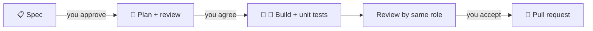

# @rakib045/agentic-sdlc-tools

An AI software team in a box. Install one kit and your coding assistant gets a product owner, a solution architect, frontend and backend developers, QA, DevOps, security and code reviewers, and an orchestrator that runs the whole software delivery loop.

It works with **Claude Code**, **OpenCode**, **OpenAI Codex**, **Gemini CLI**, **GitHub Copilot**, and **Cursor**.

- **9 agents**, each with an icon, so you can see who is working
- **10 commands**, from `/spec` to the full Jira-to-pull-request loop
- **26 skills**: engineering workflows from spec-driven development to shipping
- **1 global rule**: the team's standards and definition of done
- **3 instruction levels**: `low`, `default`, and `high`

Package: [npmjs.com/package/@rakib045/agentic-sdlc-tools](https://www.npmjs.com/package/@rakib045/agentic-sdlc-tools)

Requires [Node.js 20 or newer](https://nodejs.org/).

## Contents

- [Quick start](#quick-start)
- [Use it in your assistant](#use-it-in-your-assistant)
- [Your team](#your-team)
- [Commands](#commands)
- [The Orchestrator custom command](#the-orchestrator-custom-command)
- [Instruction levels](#instruction-levels)
- [Install and manage](#install-and-manage)
- [Where the files go](#where-the-files-go)
- [Models](#models)
- [Customize after install](#customize-after-install)
- [Repository layout](#repository-layout)

## Quick start

From your project folder, preview the files for your assistant, then install them:

```sh
npx @rakib045/agentic-sdlc-tools init --tools claude --dry-run
npx @rakib045/agentic-sdlc-tools init --tools claude --yes
```

Replace `claude` with `opencode`, `codex`, `gemini`, `github`, or `cursor`. For more than one assistant, separate the names with commas, for example `--tools claude,opencode`.

Then check the install and your project setup:

```sh
npx @rakib045/agentic-sdlc-tools doctor
```

A healthy project with `SPEC.md`, `PLAN.md`, `package.json`, and Claude Code files installed prints:

```text
PASS spec: SPEC.md
PASS plan: PLAN.md
PASS test: package.json
PASS kit: installed for [claude]

4/4 checks passed.
```

> The package is scoped, so use the full name with `npx`. The bare `npx agentic-sdlc-tools` does not resolve.

## Use it in your assistant

Reopen the project in your assistant after installing. If it does not detect the new files, reload the window or its configuration, then run `doctor` again.

| Assistant | How to start |
|---|---|
| Claude Code | Run `/spec`, `/plan`, `/build`, or any other command from the project. Each command includes its agent persona. |
| OpenCode | Run the commands the same way. Each command file is bound to its agent. |
| OpenAI Codex | Type the command name. Commands are installed as skills with implicit invocation off, so they only run when you name them. |
| Gemini CLI | Run the installed custom command, such as `/spec`. |
| GitHub Copilot | Start the command skill you want. Commands are user-started only. |
| Cursor | Type the command name in the Cursor chat, such as `/spec`. |

Commands use the same names in every tool. Some tools implement them as skills rather than native slash commands.

## Your team

| Icon | Agent | What it does |
|---|---|---|
| 🧭 | `orchestrator` | Leads the team: runs the loop, delegates each task, and asks you for decisions |
| 📋 | `product-owner` | Turns ideas into requirements, user stories, and acceptance criteria |
| 📐 | `solution-architect` | Designs the approach and writes the plan and architecture decisions |
| 🎨 | `senior-frontend-developer` | Builds user interfaces with unit tests and browser checks |
| 🔧 | `senior-backend-developer` | Builds APIs, services, data, and integrations with unit tests |
| 🧪 | `qa-engineer` | Writes tests, proves behavior, and reproduces bugs |
| 🚀 | `devops-engineer` | Sets up pipelines, releases, rollbacks, and pull requests |
| 🔒 | `security-reviewer` | Finds exploitable vulnerabilities at trust boundaries |
| 🔍 | `code-reviewer` | Reviews changes on five axes before they merge |

## Commands

### The SDLC flow

```
/spec -> /plan -> /build -> /test -> /code-review -> /deploy
```

| Command | Who runs it | What it does |
|---|---|---|
| `/spec` | 📋 product-owner | Writes `SPEC.md`, then waits for your approval |
| `/plan` | 📐 solution-architect | Writes `PLAN.md` with ordered, testable tasks. Writes no product code |
| `/build` | 🧭 orchestrator | Implements the next task test-first. `/build auto` runs every task after one approval |
| `/test` | 🧪 qa-engineer | Writes failing tests first, or reproduces a bug before it is fixed |
| `/code-review` | 🔍 code-reviewer | Reviews the current change and gives a verdict |
| `/deploy` | 🚀 devops-engineer | Runs parallel reviews, makes a go/no-go call, then releases with a rollback plan |

### Orchestrator commands

These commands run the team for you. Details are in [The Orchestrator custom command](#the-orchestrator-custom-command).

| Command | What it does |
|---|---|
| `/orches-sdlc <feature>` | Runs the whole loop from a feature description: spec, plan, build, review, and an optional pull request |
| `/orches-sdlc-jira <key or url>` | Runs the same loop from a Jira card, read through the Atlassian MCP server |
| `/orches-create-jira <bug\|feature\|task> <description>` | Clarifies a bug, feature, or task, then creates a Jira ticket, or writes the ticket text if Jira is not connected |

### Flags

| Flag | Works with | What it does |
|---|---|---|
| `/no-human-review` | `/orches-sdlc`, `/orches-sdlc-jira`, `/orches-create-jira` | Skips the confirmations that come after the work is done. Spec and plan approval still need you |

Run `npx @rakib045/agentic-sdlc-tools doctor` at any step. It checks that your spec, plan, and test setup are in place.

## The Orchestrator custom command

🧭 **orchestrator** is the team lead. You can drive each step yourself with `/spec`, `/plan`, and `/build`, or hand the whole job to one of the orchestrator commands.

| If you have | Run |
|---|---|
| A feature idea | `/orches-sdlc <describe the feature>` |
| A Jira card | `/orches-sdlc-jira PROJ-123` |
| A bug, feature, or task to write up in Jira | `/orches-create-jira bug <describe the bug>` |

### How the loop works

The orchestrator moves through these stages in order. You approve or decide at the stages marked **You**.

| Stage | Who works | What happens | You decide? |
|---|---|---|---|
| 1. Spec | 📋 product-owner | Writes `SPEC.md` with user stories and acceptance criteria | Yes: approve the spec |
| 2. Plan | 📐 solution-architect, then 📋 product-owner | Writes `PLAN.md`. The product owner checks it against the spec and sends fixes back, up to 3 automatic rounds | Yes: agree, or request changes. Revisions repeat until you agree |
| 3. Build | 🎨 frontend and 🔧 backend developers | Each task gets unit tests first, then the code, then one commit. Frontend and backend tasks run at the same time when both are ready | No |
| 4. Build review | Another agent of the same role | Reviews each task against its acceptance criteria and tests, up to 3 automatic rounds | No |
| 5. Confirm | You | Shows the build summary and test output | Yes: accept, or request changes. Changes go through the build cycle again |
| 6. Pull request | 🧭 orchestrator, then 🚀 devops-engineer | Writes the PR title and description, then creates the PR if you say yes | Yes: create the PR or not |

Each review is done by a separate agent of the same role as the builder. Frontend tasks are reviewed by another frontend developer, and backend tasks by another backend developer.



### `/orches-sdlc`

```
/orches-sdlc add CSV export to the orders page
```

Runs the full loop from a feature description. The orchestrator asks you to approve the spec and agree to the plan, builds the work, reviews it, and asks you to accept the build.

### `/orches-sdlc-jira`

```
/orches-sdlc-jira PROJ-123
/orches-sdlc-jira https://your-site.atlassian.net/browse/PROJ-123
```

Before anything else, the command checks that the Atlassian MCP server is connected.

- **Not connected:** it stops and asks you to connect Atlassian. Connect it in your assistant's MCP settings, then run the command again.
- **Connected:** it reads the card (summary, description, acceptance criteria, comments, linked issues) and runs the same loop as `/orches-sdlc`, using the card as the request. The PR title starts with the Jira key.

### `/orches-create-jira`

```
/orches-create-jira bug Login button does nothing on Safari 17
/orches-create-jira feature Let admins export audit logs as CSV
/orches-create-jira task Upgrade the logging library to v3
```

Writes a Jira-ready ticket for a bug, feature, or task. It does not build anything.

1. **Clarify.** 📋 product-owner runs `/spec` and asks up to five questions at a time: steps to reproduce and expected output for a bug; the user, the story, and the scope for a feature; the outcome and definition of done for a task.
2. **Draft.** The ticket is written for its type. A bug has steps, actual output, expected output, and acceptance criteria. A feature has a user story and Given/When/Then criteria. A task has its steps and a definition of done. Flows and processes get a Mermaid diagram.
3. **Create or output.**
   - If Jira is connected, the command asks for the project key if needed, shows the draft, and creates the issue after you confirm. It then shows the issue key and link.
   - If Jira is not connected, it outputs the ticket as copy-paste markdown, with title, description, diagram, steps, actual and expected output, acceptance criteria, assumptions, and open questions.

Issue types map as `bug` to Bug, `feature` to Story, and `task` to Task. The command checks these names against your project.

### `/no-human-review`

Add `/no-human-review` to a command to skip the confirmations that come after the work is done:

```
/orches-sdlc add CSV export to the orders page /no-human-review
/orches-sdlc-jira PROJ-123 /no-human-review
/orches-create-jira feature Let admins export audit logs as CSV /no-human-review
```

What changes with the flag:

| Command | Without the flag | With `/no-human-review` |
|---|---|---|
| `/orches-sdlc`, `/orches-sdlc-jira` | You approve the spec and agree to the plan. You accept the build. You decide on the PR | You still approve the spec and agree to the plan. The build is accepted automatically once every review approves. The PR is created automatically if a git host is connected |
| `/orches-create-jira` | You answer every essential question, confirm the spec, confirm the draft | Only questions the ticket cannot be written without are asked. Other gaps become listed assumptions. The issue is created without confirmation if Jira is connected |

The flag still stops the run for:

- an ambiguous spec, or a Jira card with missing information;
- a missing Atlassian connection, for the Jira commands;
- a failing test that cannot be fixed;
- a review still open after 3 rounds;
- any irreversible step outside creating the PR.

Even with the flag, the orchestrator never merges, releases, or pushes to the default branch. Use the flag once the scope is clear, and read the spec and plan before you agree to them, because the build follows them without stopping.

Run `/no-human-review` on its own to be asked which feature, Jira card, or ticket to run.

### The pull request decision

The orchestrator writes a PR title and description after the build is accepted. It then checks whether the project is connected to GitHub, GitLab, or Azure DevOps, either through a git remote or a connected MCP server.

| Situation | What happens |
|---|---|
| Not connected | The title and description are shown. No PR is created |
| Connected, you say **no** | The title and description are shown. No PR is created |
| Connected, you say **yes** | 🚀 `devops-engineer` creates a branch, commits the remaining changes, pushes, and opens the PR. You get the PR link |
| Connected, `/no-human-review` | The same as **yes**, without the question |

### Following the run

Every line that names an agent starts with that agent's icon, so you can follow the work:

```
🧭 orchestrator → 📋 product-owner ⏳ writing SPEC.md
📋 product-owner ✅ done
🧭 orchestrator ⏸ waiting for you: approve spec?
🧭 orchestrator → 📐 solution-architect ⏳ writing PLAN.md
🧭 orchestrator → 📋 product-owner ⏳ reviewing PLAN.md
🎨 senior-frontend-developer ⏳ task 3: login form tests
🔧 senior-backend-developer ⏳ reviewing task 3
🎨 senior-frontend-developer ✅ done
```

States are ⏳ working, ✅ done, ⛔ blocked, and ⏸ waiting for you.

### What the orchestrator will not do

- It never approves a spec, a plan, or a build on your behalf, unless you set `/no-human-review`, and even then it does not merge or release.
- It never merges a pull request or releases to production.
- It pushes a branch only when you say yes to a pull request, or when `/no-human-review` is set.
- It edits no code itself. Developers stage only their own files, never `git add -A`.
- It stops and asks when a spec is ambiguous, a test cannot pass, or a step cannot be undone.

## Instruction levels

Every agent, command, skill, and rule comes in three versions. Pick one with `--instruction-level`:

| Level | Flag | Templates | Instructions | Size vs. high |
|---|---|---|---|---|
| **low** | `--instruction-level low` | 9 agents, 10 commands, 14 skills, 1 rule (34 templates) | Shortest. Only the essentials. Agents load fewer skills | ~30% |
| **default** | no flag, or `--instruction-level default` | 9 agents, 10 commands, 26 skills, 1 rule (46 templates) | Balanced. Every workflow, trimmed for everyday use | ~67% |
| **high** | `--instruction-level high` | 9 agents, 10 commands, 26 skills, 1 rule (46 templates) | Full detail | 100% |

Template counts describe the source set. Some tools render one template into several files. Size comparisons use UTF-8 bytes of the template source. They are not token counts or billing estimates. Skills can load on demand, so actual context use depends on your assistant.

The low level installs these skills only:

`planning-and-task-breakdown`, `interview-me`, `spec-driven-development`, `adr-writing`, `api-and-interface-design`, `incremental-implementation`, `test-driven-development`, `frontend-ui-engineering`, `debugging-and-error-recovery`, `conventional-commits`, `ci-cd-and-automation`, `code-review-and-quality`, `review-checklist`, `security-and-hardening`

Installed files keep their normal names at every level. `.claude/agents/orchestrator.md` is the same path whichever level you choose.

To switch levels in a project you already set up, add `--force`. The original files are kept as `*.bak`:

```sh
npx @rakib045/agentic-sdlc-tools init --instruction-level low --force
```

## Install and manage

### Install

```sh
# everything, for every supported tool, at the default level
npx @rakib045/agentic-sdlc-tools init

# only some tools, no prompts
npx @rakib045/agentic-sdlc-tools init --tools claude,opencode --yes

# the smallest kit, for every tool
npx @rakib045/agentic-sdlc-tools init --instruction-level low --yes

# a smaller kit: spec, plan, and build, with the agents they need
npx @rakib045/agentic-sdlc-tools init --preset minimal --yes

# the full, detailed instructions
npx @rakib045/agentic-sdlc-tools init --instruction-level high --yes

# preview what would be written, without writing anything
npx @rakib045/agentic-sdlc-tools init --dry-run
```

Valid tool names: `claude`, `opencode`, `codex`, `gemini`, `github`, `cursor`.
Valid levels: `low`, `default`, `high`. Any other value is rejected with an error.

### Add pieces one at a time

```sh
npx @rakib045/agentic-sdlc-tools list                          # every name, at the default level
npx @rakib045/agentic-sdlc-tools list --instruction-level low  # the names at the low level
npx @rakib045/agentic-sdlc-tools list --tools                  # where each tool reads its files

npx @rakib045/agentic-sdlc-tools add agent:orchestrator --tools claude,github
npx @rakib045/agentic-sdlc-tools add command:orches-sdlc --tools opencode
npx @rakib045/agentic-sdlc-tools add skill:adr-writing
npx @rakib045/agentic-sdlc-tools add rule:global --tools cursor --instruction-level high
```

Names use the form `<type>:<name>`, where type is `agent`, `command`, `skill`, or `rule`.

### Keep it up to date

```sh
npx @rakib045/agentic-sdlc-tools update --check                          # report what would change
npx @rakib045/agentic-sdlc-tools update --diff                           # the same, file by file
npx @rakib045/agentic-sdlc-tools update --force                          # apply the updates
npx @rakib045/agentic-sdlc-tools update --instruction-level low --force  # refresh a low install
npx @rakib045/agentic-sdlc-tools doctor                                  # check spec, plan, test setup, and the install
```

Use the same level for `update` that you installed with. `update` refreshes only the files you already have, at the level you name. Without the flag it uses `default`.

### Your edits are safe

`init` and `add` never overwrite a file you changed. They stop with a conflict instead. With `--force`, the original is saved as `*.bak` first. `update` refreshes only files you already installed, and never adds items you did not choose. Running `init` again does nothing if nothing changed.

## Where the files go

| Tool | Agents | Commands | Skills | Rules |
|---|---|---|---|---|
| Claude Code | `.claude/agents/<id>.md` | `.claude/commands/<id>.md` | `.claude/skills/<id>/SKILL.md` | `CLAUDE.md` |
| OpenCode | `.opencode/agents/<id>.md` | `.opencode/commands/<id>.md` | `.opencode/skills/<id>/SKILL.md` | `AGENTS.md` |
| OpenAI Codex | `.codex/agents/<id>.toml` | `.agents/skills/<id>/SKILL.md` | `.agents/skills/<id>/SKILL.md` | `AGENTS.md` |
| Gemini CLI | `.gemini/agents/<id>.md` | `.gemini/commands/<id>.toml` | `.gemini/skills/<id>/SKILL.md` | `GEMINI.md` |
| GitHub Copilot | `.github/agents/<id>.agent.md` | `.github/skills/<id>/SKILL.md` | `.github/skills/<id>/SKILL.md` | `.github/copilot-instructions.md` |
| Cursor | `.cursor/agents/<id>.md` | `.cursor/commands/<id>.md` | `.cursor/skills/<id>/SKILL.md` | `.cursor/rules/global.mdc` |

Each tool gets the format it reads:

- **Claude Code** custom sub-agents cannot start other sub-agents. Run orchestration from the main conversation. `/build` includes the orchestrator persona in its command prompt.
- **OpenCode** reads commands and agents as markdown with frontmatter. Permissions are written as they are.
- **OpenAI Codex** no longer supports custom prompts, so its commands are skills. They only run when you type the command name.
- **Gemini** commands are TOML files with a description and a prompt.
- **Cursor** reads commands from `.cursor/commands` as plain markdown. It ignores plain `.md` rules, so the global rule is an `.mdc` file that always applies.
- **GitHub Copilot** runs commands as skills that only you can start.

## Models

The kit does not pin a model for any agent. Every agent uses `model: inherit`, so it runs on the model your session already uses. Change your model once and the whole team follows.

- **Claude Code** and **Cursor** receive `inherit` directly.
- **OpenCode**, **Codex**, **Gemini**, and **GitHub Copilot** have no `inherit` setting. Their files leave the model field out, which means the same thing.

Reasoning effort is still set per agent with `effort:`. It applies to Claude Code and Codex. Other tools use the effort set in your session.

## Customize after install

Installed files are plain files. You can edit them freely.

| Where | What you can change |
|---|---|
| Agents | `description`, `icon`, `mode`, `model`, `permissions`, `effort`, and the prompt body |
| Commands | `description`, the bound agent, and the prompt body |
| Skills | `description` (it decides when the assistant loads the skill) and the body |

Fields a tool does not read are ignored.

Permissions control what each agent can do. The orchestrator can delegate to every other agent, and `devops-engineer` can launch the reviewers. The other agents work on their own. The code and security reviewers are read-only.

## Repository layout

```
agents/ commands/ rules/ skills/   # single source of truth: edit these
src/                               # TypeScript CLI and one adapter per tool
src/lib/manifest.ts                # instruction levels and template lookup
src/lib/source.ts                  # reads template frontmatter (icon, model, skills, permissions)
scripts/copy-templates.mjs         # copies the templates into dist/ on build
tests/                             # vitest
```

Every template exists in up to three versions, named by level:

```
agents/orchestrator.md.low         # low: shortest instructions, fewer skills bound
agents/orchestrator.md             # default: balanced
agents/orchestrator.md.high        # high: full detail
skills/<id>/SKILL.md.low           # low files exist only for the 14 low-level skills
skills/<id>/SKILL.md               # default: all 26 skills
skills/<id>/SKILL.md.high
```

Each skill is one folder with a `SKILL.md` file. The installer drops the level suffix and writes the chosen version under the plain name.

When you change a template, change the same item at every level it exists at. Tests check that low files reference only low skills, that each agent's "Load these skills" list matches its binding, and that low is shorter than default, which is shorter than high.

## License

MIT. See [LICENSE](LICENSE).
